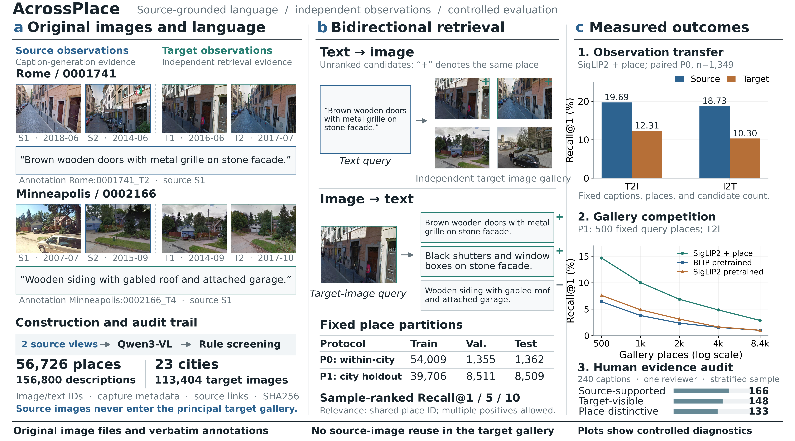

<div align="center">

# 📍🌍🏙️AcrossPlace🚗🤖🧠
### Do Vision–Language Models Recognize Places Beyond Their Source Views?
**🗃️A Comprehensive Benchmark for Cross-View Bidirectional Place Recognition**
**Zhenyu Li, Tianyi Shang, Shuhan Dong, Ruotong Xu, Qingyu Zhu**
**Qilu University of Technology (Shandong Academy of Sciences) & Purdue University**

[Project website](https://acrossplace.ornatesparrow2.chatgpt.site) · [Data browser](https://acrossplace.ornatesparrow2.chatgpt.site/#explorer) · [Retrieval lab](https://acrossplace.ornatesparrow2.chatgpt.site/#demo) · [Dataset download (Google Drive)](https://drive.google.com/file/d/13639QpS-GX7ZeibqKaxd45dHxIo5Cf5W/view?usp=drive_link) · [📄Paper](https://arxiv.org/pdf/2611.15314)

**56,726 places · 23 cities · 156,800 rule-valid descriptions · 113,404 target images**



</div>

AcrossPlace evaluates whether language–vision models retrieve **the same physical place across independent views**, rather than recognize the exact image that supplied a caption. It builds on GSV-Cities with traceable generated descriptions, separate source and target views, fixed place partitions, bidirectional relevance and diagnostic evaluations. This repository releases the construction pipeline, benchmark protocols, baseline training/testing code, measured results and the interactive project website.

This is a **benchmark release**, not a claim of a new retrieval architecture. Paper files are withheld from the public release.

## What is included

| Component | Location |
|---|---|
| Qwen3-VL / vLLM generation, quality filtering, formalization, append-only extension | [`generation/`](generation/README.md) |
| Frozen P0 identity and place assignments; deterministic P1 city allocation | [`protocols/`](protocols/README.md) |
| CLIP / SigLIP2 / BLIP encoders, place loss, MS loss, LoRA and adaptation ablations | [`src/place_retrieval/`](src/place_retrieval/) |
| Training, validation-only checkpoint/reranking selection, test evaluation | [`docs/REPRODUCE.md`](docs/REPRODUCE.md) |
| Cross-view transfer, matched galleries, gallery scaling, rule/human quality diagnostics | [`diagnostics/`](diagnostics/README.md) |
| Per-seed metrics, aggregate tables, curves and human review | [`results/`](results/README.md) |
| Real-image explorer, interactive leaderboard and recorded bidirectional retrieval | [`website/`](website/README.md) |

## Quick start

Use Python 3.11 on a CUDA-capable Linux machine for training. CPU tests run without model downloads.

```bash
git clone https://github.com/CV4RA/AcrossPlace.git
cd AcrossPlace
python -m venv .venv
source .venv/bin/activate
# Install a PyTorch build appropriate for your CUDA driver first if necessary.
pip install -e ".[dev]"
python scripts/download_models.py --model all --output artifacts
```

Prepare the frozen formal metadata and independently obtained GSV-Cities images as described in [DATA.md](docs/DATA.md). Configure `data.formal`, `data.image_root` and model directories in `configs/gsv_full.yaml`. Canonical paths inside records remain unchanged; `canonical_prefix` remaps them locally.

```bash
place-retrieval verify-data --config configs/gsv_full.yaml --check-images
place-retrieval run --config configs/gsv_full.yaml
```

`run` is one complete pipeline: public pretrained initialization → place-supervised training → validation selection → fixed test evaluation. It does not require a historical B0 run or an R1 checkpoint. The default recipe is SigLIP2 + place supervision; the study planner also emits the BLIP+MS, CLIP, zero-shot and adaptation-ablation recipes. See [the reproduction guide](docs/REPRODUCE.md) for all methods, P1, resumable training, frozen study testing and output formats.

## Protocols and primary results

| Protocol | Train places | Val places | Test places | Test texts | Test target images |
|---|---:|---:|---:|---:|---:|
| P0: unseen places in represented cities | 54,009 | 1,355 | 1,362 | 3,798 | 2,724 |
| P1: held-out cities | 39,706 | 8,511 | 8,509 | 23,369 | 17,014 |

Main results below are **test Recall@1 (%)**, rounded; full Recall@1/5/10 and seed variation are in [`results/`](results/). Reranking uses a fixed pretrained BLIP cross-encoder and a validation-selected fusion weight.

| Baseline | P0 T2I | P0 I2T | P1 T2I | P1 I2T |
|---|---:|---:|---:|---:|
| SigLIP2 + place, coarse | 12.95 | 13.64 | 3.68 | 3.46 |
| SigLIP2 + place, selected reranking | 15.24 | 17.35 | 5.21 | 5.72 |
| BLIP + MS, coarse | **17.54** | **23.62** | 6.09 | **8.36** |
| BLIP + MS, selected reranking | 16.87 | 21.28 | **6.23** | 8.18 |

Scores average three training seeds. The common training budget is three epochs, not a convergence claim. P0/P1 differ in training size, candidate count and query cohort, so their score gap does not isolate a causal geographic-generalization effect. The original P0 test set had been inspected before the frozen reruns; it is not an author-blind holdout. Automated `valid` status is not human ground truth. The 240-item, single-reviewer human audit is balanced by rule status and supports descriptive diagnosis, not population prevalence estimates. [weight download](https://drive.google.com/drive/folders/1c4yCzIWvGZ8s4e8xViz-fbj69k89PLMm?usp=sharing)

## Local retrieval and website

```bash
python scripts/retrieve.py build-index --config configs/gsv_full.yaml \
  --checkpoint runs/gsv_full/coarse/best.pt --index runs/demo-index.pt
python scripts/retrieve.py query --config configs/gsv_full.yaml \
  --checkpoint runs/gsv_full/coarse/best.pt --index runs/demo-index.pt \
  --text "A stone building with wooden doors and black shutters."
# Or: --image /path/to/query.jpg
```

This local endpoint performs real **coarse** retrieval. The public website replays archived top-1 predictions and does not host a GPU or pretend to run arbitrary queries. To serve it locally:

```bash
python -m http.server 4173 --directory website/dist --bind 127.0.0.1
# Open http://127.0.0.1:4173
```

## Verification

```bash
pytest -q
cd website && node --test tests/data.test.js
```

The retrieval tests use actual tiny Transformers backbones and test gradients in both encoders, checkpoint restoration, multi-positive relevance, deterministic ranking, validation selection and test guards. Generation has its own isolated environment and tests. No benchmark training is started by these tests.

## Data, weights and licensing

Raw imagery archives and model weights are intentionally separate from Git. The repository includes small attributed research illustrations and exact image hashes; their upstream terms still apply. Download the AcrossPlace dataset from [Google Drive](https://drive.google.com/file/d/13639QpS-GX7ZeibqKaxd45dHxIo5Cf5W/view?usp=drive_link). See [DATA.md](docs/DATA.md) for data preparation and verification. Do not reconstruct the frozen main split by randomly re-splitting a new generation run.

Original software: [MIT](LICENSE). Data, model weights, and third-party assets: [separate upstream terms](THIRD_PARTY_NOTICES.md). If you use this research draft, cite the project repository until an archival publication identifier is available; no DOI or conference citation is invented here.
